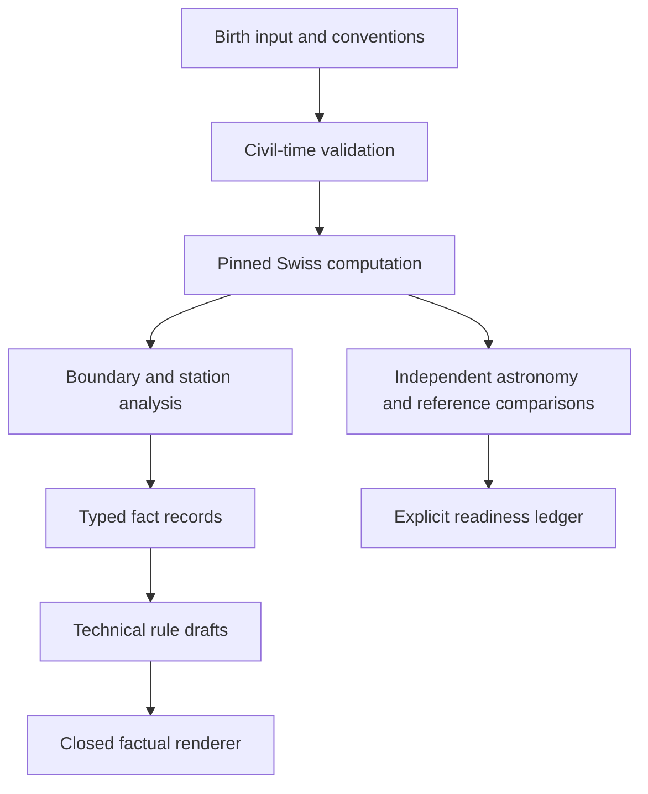

# Accuracy architecture

The v2.1 revision supersedes the older raw-text RAG plan. This build takes the user's narrowed scope: a local core-model workbench, without messaging, payments or public hosting.

## Implemented accuracy decisions

1. **One source of numerical truth.** The LLM never calculates the sky. Ephemeris files, binary/binding versions, civil timezone data and all conventions are included in provenance. Swiss global settings are serialized; node modes cannot race between requests. Returned backend flags are checked to reject silent Moshier substitution.
2. **Separate identities.** The natal hash includes normalized UTC/window, location, time convention, kernel hashes and versioned calculation settings. The run hash additionally includes `as_of` and the uncertainty switch. A different display place label cannot alter the calculation.
3. **Civil time is an input with provenance.** Pinned `tzdata` is opened directly from the wheel; the host OS database is not consulted. Gaps fail. Overlaps require a fold or an explicit recorded offset. Unknown time uses the actual local civil day, including 23/25-hour DST days. Historical city-specific time can require a record-based override; a modern zone name is not treated as proof of the historical practice.
4. **Half-open boundaries.** Longitude bins use integer microarcseconds without rounding displayed degrees back into calculations. Varga signs implement one named reference method; D30 is not treated as equal divisions.
5. **Time robustness improves on four-minute voting.** Angular boundaries for every supported varga/nakshatra/pada are enumerated. Planetary stations split monotonic sections; crossings are bracketed at 20 seconds and bisected to 0.02 seconds. Facts are weighted by interval duration. A 'stable' claim requires unanimity. High-latitude ascendant stability is conservatively withheld. This is a numerical method under physical monotonicity/resolution assumptions, not an algebraic proof or a calibrated probability.
6. **Different uncertainty domains stay separate.** The angular procedure does not certify dasha extrema, strength thresholds or source interpretations. Dasha endpoint scenarios are labeled as scenarios, never guaranteed ranges. Unknown time never produces a nominal ascendant or an invented Lagna AV contribution.
7. **Sources can be wrong.** A fixed publication is provenance, not infallibility. The D27 example 23 contradicts its own preceding counting rule; the published result and independently counted result are both retained in triage. That example is excluded from approved oracle values and remains a review blocker. No test tolerance was relaxed to absorb the disagreement.
8. **Interpretations need more than rare facts.** A rare Moon position can support generic prose; fact rarity is not itself a Barnum detector. No predictive-confidence scalar is manufactured. The two current source-linked rule drafts detect configurations only, with no approved interpretive effects.
9. **Testing layers are explicit.** Skyfield is an independently implemented calculation path over JPL DE440s. Agreement does not prove independent observational evidence because ephemerides share underlying astronomical measurements. JHora/AstroSage comparisons establish Jyotish convention compatibility; they are not counted as an independent astronomy engine.
10. **Review state is executable.** Typed rules reject unknown operators, undeclared dependencies, missing sources and approval states without distinct attestations. This schema check cannot itself authenticate a reviewer; production promotion must be controlled through the review process. There are zero approved predictive rules in this release.

## Next implementation sequence

- Complete source-adopted computational definitions for remaining strength measures and other M1 calculations; acquire worked examples before claiming validation.
- Import 30 paired JHora/AstroSage fixture outputs and official PAC panchang checks; triage convention differences without changing tolerances.
- Build the verse-aligned corpus and full condition/exception/effect rule language with two independent encodings and adjudication.
- Enable a versioned model provider only after these gates. The future dossier planner must cite fired rules/facts, the validator must check conditions/timing/polarity, and the verifier must check verses and contradictory sources. A second call to the same model is not independent proof.
- Run expert concordance and prospective outcome studies separately. Consistency from persistence is useful, but can consistently preserve an error; it is not a substitute for correctness.

## Runtime and privacy

FastAPI serves static HTML/CSS/JS and typed JSON endpoints. The chart API is stateless. No database, analytics or external model call sees birth inputs. Reference import compares in memory. Synthetic evaluation reports use a local `var/evals` directory, overridable by `JYOTI_EVAL_DIR`; read-only preview environments can retain results in memory. The npm wrapper supports the managed internal QA supervisor; normal local use needs only Python and uv.
